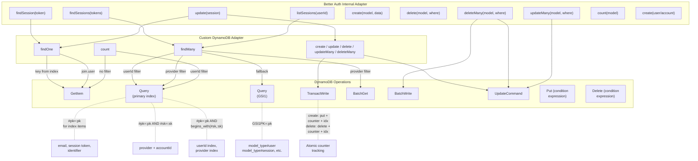
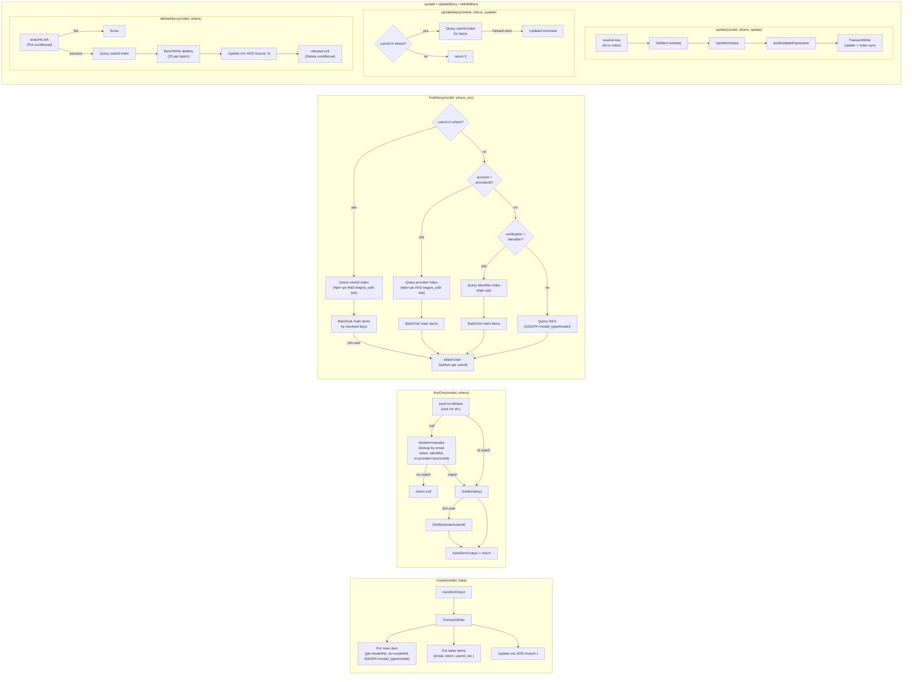

# Better Auth DynamoDB Adapter

## Table Schema

A single `Data` table with two indexes:

| Index | Hash Key | Range Key |
|---|---|---|
| Primary | `pk` | `sk` |
| GSI1 | `GSI1PK` | `GSI1SK` |

## Item Types and Key Patterns

| Type | `pk` | `sk` | `GSI1PK` | `GSI1SK` |
|---|---|---|---|---|
| **Main item** | `{model}#{id}` | `{model}#{id}` | `model_type#{model}` | `{model}#{id}` |
| **Counter** | `_cnt#{model}` | `_cnt#{model}` | — | — |
| **Email index** | `_idx#user_email#{email}` | `user#{id}` | — | — |
| **Session token index** | `_idx#session_token#{token}` | `session#{id}` | — | — |
| **Identifier index** | `_idx#identifier#{val}` | `verification#{id}` | — | — |
| **Provider index** | `_idx#provider#{providerId}` | `account#{accountId}` | — | — |
| **UserId index** | `_idx#userId#{userId}` | `{model}#{id}` | — | — |
| **Lock** | `_lock#{scope}` | `_lock#{scope}` | — | — |

Models: `user`, `session`, `account`, `verification`.

## DynamoDB Operations

### GetItem
Direct key lookup after resolving the key via an index query. Used by `update`, `delete`, `findOne` (after index lookup), `deleteMany`, and the counter fallback in `count`.

### Query (primary index)
All query calls use **equality on `pk`** (hash key). The `begins_with` function is only applied to `sk` (sort key).

| Pattern | Purpose |
|---|---|
| `#pk = :pk` | Resolve email, session token, or verification identifier index items |
| `#pk = :pk AND #sk = :sk` | Resolve account by `providerId` + `accountId` |
| `#pk = :pk AND begins_with(#sk, :sk)` | Find all items of a model for a given `userId`; find all accounts for a `providerId` |
| Same as above + `Select: COUNT` | Count items by `userId` |

### Query (GSI1)
| Pattern | Purpose |
|---|---|
| `#pk1 = :pk1` with `GSI1PK = model_type#{model}` | Fallback `findMany` when no `userId`/`providerId` filter is present |

### TransactWrite (atomic multi-item)
Used by `create`, `update`, and `delete` to atomically write the main item, index items, and counter updates:

- **Create**: Put main item + Put index items + Update counter (ADD 1)
- **Update**: UpdateExpression + conditional Put/Delete index items if reindexing needed
- **Delete**: Delete main item + Delete index items + Update counter (ADD -1)

### BatchGet
Fetch main items in bulk after resolving their keys from index queries.

### BatchWrite
Delete main + index items in batches of 25 (used by `deleteMany`).

### UpdateCommand
- Individual item updates in `updateMany` (one per item found by `userId`)
- Atomic counter increment/decrement via `ADD #count :inc` / `ADD #count :dec`

### Put (conditional)
Acquire distributed lock: `attribute_not_exists(token) OR expiresAt < :now`.

### Delete (conditional)
Release distributed lock: `#token = :token`.

---

## Query Flow



---

## Operation Details



---

## Performance Benchmarks

Run from local machine to DynamoDB (us-east-1) over internet. In production (Lambda in-region), expect **5-10x lower** latencies.

**Setup**: 100 users + 50 sessions seeded. Each operation iterated N times (100 for single-item, 20 for GSI1/count, 10 for userId queries).

| Operation | p50 (ms) | p95 (ms) | DynamoDB Calls |
|---|---|---|---|
| **findUserById** | 97 | 112 | 1 GetItem |
| **findUserByEmail** | 204 | 303 | 2 GetItems (index → main) |
| **findSessionByToken** | 204 | 222 | 2 GetItems (index → main) |
| **listUsers (GSI1)** | 99 | 214 | 1 Query on GSI |
| **countUsers** | 94 | 156 | 1 GetItem (counter) |
| **findSessionsByUserId** | 201 | 215 | 1 Query + 1 BatchGet |

**Key findings**:
- All access patterns use proper key-based lookups (primary key or GSI hash key with equality) — **no scans or expensive operations**.
- Multi-item lookups (email, session token, userId) add one sequential GetItem for the index pointer, roughly doubling latency vs direct ID lookup.
- **Performance is O(1) with respect to table size** — DynamoDB GetItem/Query latency on hash key does not degrade as the table grows.
- Bulk counter via `TransactWrite` `ADD` and counter GetItem are both sub-millisecond DynamoDB operations (network-bound here).

Run the benchmark yourself:
```bash
AWS_PROFILE=personal npx tsx scripts/benchmark-auth.ts <table-name> --seed --cleanup
```
